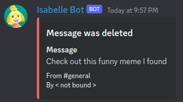

# Isabelle Bot
## v3

Isabelle Bot is a Discord bot powered by [Discord.js](https://discord.js.org). It started out back in 2018 as a small project to replicate some of the fun commands from a Twitch channel I moderate for in her Discord server. After a while, more complexity was added, such as commands that had more interaction and even did a little bit of moderation such as banning users and auditing edited and deleted messages. With some of the major changes that came with Discord's own API and getting some free time in my personal life Isabelle Bot is being re-worked.

I continue to update and change Isabelle Bot to get more experience in developing Node.js applications and expanding my programming skills and knowhow along the way. As the community comes up with more features and requests I plan to add what I can and update where needed.

# What does she do?

## Basics

* Has basic commands (you can see how they work in the `commands` directory)
* - `/caw` - Will respond with "Caw caw, baby" (a reference to the streams)
* - `/hug $USER` - A way to send hugs to a user or just send out a hug in general if no user is mentioned
* Audits edited and deleted messages
* - She does not save images. If the post has an image then nothing will show up on the event logs except for whatever the message contains. So if a post has an image with the message "check out this cool thing I found!" then the only thing that will get saved to the logs is the message but not the image. For safety reasons I would rather not have any images saved.

<picture>
    
    <figcaption>An example of a log of a deleted image that contains an image.</figcaption>
</picture>

## Star Board - Reading challenge

Several memebers of the community came up with a challenge that helps encourage users who wish to read more. Anyone in the server is welcomed to join in. The rules of the challenge is simple:

* Read 30 minutes a day.
* If you have done your reading then you leave a star.
* Miss a day and you will lose your streak.
* Only one star can be earned each day
* Total number of stars are tracked so there's still a way to see reading progress

Where Isabelle comes in is to help with tracking the stars. Originally a user was doing it all on their own updating a message to have a leaderboard on display. Isabelle helps with this.

* Leave a star with `/star` instead of the original method that people were using where they would leave an emoji.
* Isabelle updates a local database including what time someone leaves a star.
* Every day at 6am CST Isabelle will send a message to a specific channel reminding everyone that it's a new day and to leave their star. She also displays a leaderboard to show what the current records are.
* If users wish to see a current leaderboard before the start of a new day they can with the `/starboard` command.

## Star Board - Workout stars

On top of the reading challenges, another idea was sprung up where users are encouraged to workout often and earn stars through workouts. The rules are a bit different:

* Workout (whatever is within your limits) for 30 minutes a day
* Working out 4 times a week will earn you a super star
* Mondays is the start of a new week and will reset super star chances if one was not obtained already.

# How does she run?

~~With legs. Thanks for attending my TED Talk.~~

The code is all running on an old laptop that is running Node.js on a headless Debian set up. Not exactly the most ideal solution, but I do plan on switching over to a cloud-based solution again soon. Since Isabelle is running for a single Discord server and doesn't have to do a lot of memory or CPU intensive tasks, it does the job.

# Anything I should know before eyeing on your code?

Usually when I write code I try to focus on making sure the code can be maintained easily, such as avoiding hardcoding things, or avoid repeating code, or over-complicating it. Admittedly I didn't do it as much as I would've liked to, but I was in a hurry to try and get Isabelle back online after she was offline for about 2 years due to many complications. I did better than my earlier coding practices.

I have a list of things that I am trying to accomplish, such as getting the old dev branch on track again and refactoring some of my code. So if you happen to be one of those weirdos who like to poke around on random repos, feel free to chime in if you have a complaint, just don't be rude about it, please.